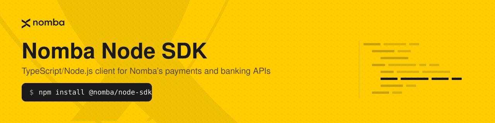

<picture>
  <source media="(prefers-color-scheme: dark)" srcset=".github/assets/banner-dark.svg">
  
</picture>

# Nomba Node SDK

TypeScript/Node.js client for [Nomba's](https://nomba.com) payments and banking APIs.

[](https://github.com/NombaOSS/nomba-node-sdk/actions/workflows/ci.yml)
[](https://www.npmjs.com/package/@nomba/node-sdk)
[](LICENSE)

- Checkout, transfers, virtual accounts, direct debits, terminals, electricity, cable TV, betting, airtime and data, cross-border payouts and collections, webhooks, and account/transaction lookups.
- Built for production use: automatic token management, safe retries, idempotent mutations, and cursor pagination.
- Requires Node.js **22** or newer (see `.nvmrc`) and a Nomba account with API credentials (`clientId`, `clientSecret`, `accountId`) from the [Nomba dashboard](https://nomba.com).

## Install

```bash
npm install @nomba/node-sdk
```

## Quickstart

```ts
import { Nomba } from "@nomba/node-sdk";

const nomba = new Nomba({
  clientId: process.env.NOMBA_CLIENT_ID!,
  clientSecret: process.env.NOMBA_CLIENT_SECRET!,
  accountId: process.env.NOMBA_ACCOUNT_ID!,
  environment: "sandbox", // "production" (default) or "sandbox"
});

const order = await nomba.checkout.createOrder({
  order: {
    orderReference: "order-1234",
    customerEmail: "customer@example.com",
    amount: 5000,
    currency: "NGN",
    callbackUrl: "https://example.com/callback",
  },
});

console.log(order.checkoutLink); // send the customer here to pay
```

The SDK issues an access token on first use and refreshes it automatically before it expires — no manual token handling required.

## Configuration

```ts
new Nomba({
  clientId: string;
  clientSecret: string;
  accountId: string;          // parent account ID of the business
  environment?: "production" | "sandbox"; // default: "production"
  tokenStore?: TokenStore;    // default: in-memory, single process
  onStoreError?: (error: unknown) => void;
  timeoutMs?: number;         // default: 30000
  maxAttempts?: number;       // default: 3 (GET/429 retries); 1 disables retries
  retryDelayMs?: number;      // default: 500, doubles each retry
  fetch?: typeof fetch;       // default: the global fetch (inject a proxy, tracing or a mock)
  onRequest?: (info) => void;  // before each HTTP attempt: { method, path, attempt }
  onResponse?: (info) => void; // after each attempt: adds { httpStatus, code, durationMs }
  onOutcome?: (event) => void; // once per money-moving call: { method, path, outcome, code, status, idempotencyKey }
});
```

Hooks are for logging, metrics and alerting. An error thrown inside one is logged and never fails the request.

Credentials and `environment` must match — sandbox credentials only work against `environment: "sandbox"`.

### Sharing a token across multiple instances

Nomba allows a single active session per client. If you run more than one process/instance, provide a shared `TokenStore` (e.g. backed by Redis or a database) so they don't invalidate each other's tokens:

```ts
import type { TokenStore, TokenData } from "@nomba/node-sdk";

class RedisTokenStore implements TokenStore {
  async get(): Promise<TokenData | undefined> { /* ... */ }
  async set(token: TokenData): Promise<void> { /* ... */ }
  async clear(): Promise<void> { /* ... */ }
  async lock<T>(fn: () => Promise<T>): Promise<T> { /* ... */ } // must expire (TTL)
}

const nomba = new Nomba({ ...credentials, tokenStore: new RedisTokenStore() });
```

Store errors never fail a request — the SDK falls back to its in-process copy of the token and reports the error via `onStoreError`.

## Resources

Every resource hangs off the client (`nomba.<resource>`), and every method maps to one documented Nomba endpoint. Methods return the response's `data` directly, typed. Each money-moving call takes its idempotency key from its params (`merchantTxRef`, `transactionId` or `idempotencyKey`), not from an options argument.

| Resource | Covers |
|---|---|
| [`nomba.accounts`](#accounts) | Parent and sub-account details, balances, assigned terminals |
| [`nomba.virtualAccounts`](#virtual-accounts) | Create, update, expire, look up and list virtual accounts |
| [`nomba.checkout`](#checkout) | Hosted checkout orders, refunds, tokenized cards |
| [`nomba.charge`](#charge) | Custom card payment flow: card details, OTP, saved cards, pay by transfer |
| [`nomba.transfers`](#transfers) | Bank list, account lookup, bank and wallet transfers |
| [`nomba.directDebits`](#direct-debits) | Direct debit mandates: create, debit, list, suspend or reactivate |
| [`nomba.terminals`](#terminals) | Assign and unassign POS terminals, push payment requests |
| [`nomba.transactions`](#transactions) | List and filter transactions on parent, sub and virtual accounts |
| [`nomba.requery`](#requery) | Look up one transaction's current status |
| [`nomba.electricity`](#electricity-cable-tv-and-betting) | Electricity payments (version 2) |
| [`nomba.cable`](#electricity-cable-tv-and-betting) | Cable TV subscriptions (version 2) |
| [`nomba.betting`](#electricity-cable-tv-and-betting) | Betting top-ups (version 2) |
| [`nomba.airtime`](#airtime) | Airtime top-ups (version 2) |
| [`nomba.data`](#data) | Data bundles (version 2) |
| [`nomba.globalCollections`](#global-collections) | DRC mobile money collections |
| [`nomba.globalPayout`](#global-payout) | Currency wallets, exchange rates, cross-border transfers |
| [`nomba.webhooks`](#webhook-troubleshooting) | Webhook delivery logs, re-push and replay |
| [`verifyWebhook`](#webhooks) | Check a webhook's signature (a standalone function) |

## API reference

### Authentication

Token handling is automatic, but the client exposes it directly too:

| Method | Endpoint | Notes |
|---|---|---|
| `nomba.issueToken()` | `POST /v1/auth/token/issue` | Get a new token (normally done for you on first use) |
| `nomba.refreshToken()` | `POST /v1/auth/token/refresh` | Refresh the stored token (normally done 5 minutes before expiry) |
| `nomba.revokeToken()` | `POST /v1/auth/token/revoke` | End the session, e.g. on shutdown. Does nothing if no token is held |

### Accounts

| Method | Endpoint | Notes |
|---|---|---|
| `getParentAccount()` | `GET /v1/accounts/parent` | |
| `getParentBalance()` | `GET /v1/accounts/balance` | NGN only; use `globalPayout.listAccounts()` for other currencies |
| `getSubAccount(lookup?)` | `GET /v1/accounts/sub-account-details` | |
| `getSubAccountBalance(subAccountId)` | `GET /v1/accounts/{subAccountId}/balance` | |
| `listParentTerminals(params?)` / `iterateParentTerminals(params?)` | `GET /v1/accounts/terminals` | Paginated |
| `listSubAccountTerminals(accountId, params?)` / `iterateSubAccountTerminals(...)` | `GET /v1/accounts/{accountId}/terminals` | Paginated |

### Virtual accounts

| Method | Endpoint | Notes |
|---|---|---|
| `create(params)` | `POST /v1/accounts/virtual` | |
| `createForSubAccount(subAccountId, params)` | `POST /v1/accounts/virtual/{subAccountId}` | Funds land in that sub account |
| `get(identifier)` | `GET /v1/accounts/virtual/{identifier}` | `identifier` is the `accountRef` or the account number |
| `update(identifier, params)` | `PUT /v1/accounts/virtual/{identifier}` | |
| `expire(identifier)` | `DELETE /v1/accounts/virtual/{identifier}` | Stops the account accepting payments |
| `list(filter?, page?)` / `iterate(filter?, page?)` | `POST /v1/accounts/virtual/list` | Paginated |

### Checkout

| Method | Endpoint | Notes |
|---|---|---|
| `createOrder(params)` | `POST /v1/checkout/order` | Send the customer to `checkoutLink` |
| `fetchTransaction(params?)` | `GET /v1/checkout/transaction` | |
| `cancelOrder(orderReference)` | `POST /v1/checkout/order/cancel` | Unpaid orders only; use `refund` after payment |
| `refund(params)` | `POST /v1/checkout/refund` | |
| `chargeTokenizedCard(params)` | `POST /v1/checkout/tokenized-card-payment` | Check `status`; if `otpRequired`, submit the OTP via `ChargeService.submitCardOtp` using the returned `transactionId` |
| `listTokenizedCards(params?)` / `iterateTokenizedCards(params?)` | `GET /v1/checkout/tokenized-card-data` | Paginated |
| `updateTokenizedCard(params)` | `POST /v1/checkout/tokenized-card-data` | |
| `deleteTokenizedCard(tokenKey)` | `DELETE /v1/checkout/tokenized-card-data` | |

### Charge

For building your own payment page on top of a checkout order.

| Method | Endpoint | Notes |
|---|---|---|
| `getOrder(orderReference)` | `GET /v1/checkout/order/{orderReference}` | |
| `submitCardDetails(params)` | `POST /v1/checkout/checkout-card-detail` | |
| `submitCardOtp(params)` | `POST /v1/checkout/checkout-card-otp` | |
| `resendOtp(orderReference)` | `POST /v1/checkout/resend-otp` | |
| `fetchTransactionDetails(orderReference)` | `POST /v1/checkout/confirm-transaction-receipt` | Status after the OTP or a transfer |
| `fetchFlashAccount(orderReference)` | `GET /v1/checkout/get-checkout-kta/{orderReference}` | An account number the customer can pay into |
| `cancelTransaction(params)` | `POST /v1/checkout/transaction/cancel` | |
| `requestSavedCardsOtp(orderReference)` / `getSavedCards(orderReference, otp)` | `POST /v1/checkout/user-card/saved-card/auth`, `GET /v1/checkout/user-card/{orderReference}` | Pay with a saved card |
| `requestSaveCardOtp(params)` / `submitSaveCardOtp(params)` | `POST /v1/checkout/user-card/auth`, `POST /v1/checkout/user-card` | Save a card after payment |

### Transfers

| Method | Endpoint | Notes |
|---|---|---|
| `listBanks()` | `GET /v1/transfers/banks` | |
| `lookupBankAccount({ accountNumber, bankCode })` | `POST /v1/transfers/bank/lookup` | |
| `bankTransfer(params)` | `POST /v2/transfers/bank` | Idempotency key is `merchantTxRef` (required) |
| `bankTransferFromSubAccount(subAccountId, params)` | `POST /v2/transfers/bank/{subAccountId}` | Nomba must enable this for your account |
| `walletTransfer(params)` | `POST /v2/transfers/wallet` | To another Nomba account |
| `walletTransferFromSubAccount(subAccountId, params)` | `POST /v2/transfers/wallet/{subAccountId}` | |

A `status` of `PENDING_BILLING` means the transfer is still processing: wait for the webhook or requery, and never send it again under a new reference.

### Direct debits

| Method | Endpoint | Notes |
|---|---|---|
| `createMandate(params)` | `POST /v1/direct-debits` | |
| `getMandateStatus(mandateId)` | `GET /v1/direct-debits/status` | |
| `debitMandate(params)` | `POST /v1/direct-debits/debit-mandate` | |
| `listMandates(params)` | `GET /v1/direct-debits/mandates` | |
| `updateMandateStatus(params)` | `PUT /v1/direct-debits/update-status` | Suspend or reactivate |

### Terminals

| Method | Endpoint | Notes |
|---|---|---|
| `assignToParent(params)` / `unassignFromParent(params)` | `POST /v1/terminals/assign`, `/unassign` | |
| `assignToSubAccount(subAccountId, params)` / `unassignFromSubAccount(...)` | `POST /v1/terminals/assign/{subAccountId}`, `/unassign/{subAccountId}` | |
| `pushPaymentRequest(terminalId, params)` | `POST /v1/terminals/payment-request/{terminalId}` | Prompts payment on the device |

### Transactions

| Method | Endpoint | Notes |
|---|---|---|
| `listBankTransactions(params?)` / `iterateBankTransactions(...)` | `GET /v1/transactions/bank` | Credits and debits on the parent account |
| `listParentTransactions(params?)` / `iterateParentTransactions(...)` | `GET /v1/transactions/accounts` | |
| `listSubAccountTransactions(subAccountId, params?)` / `iterateSubAccountTransactions(...)` | `GET /v1/transactions/accounts/{subAccountId}` | |
| `filterParentTransactions(filter?, page?)` / `iterateFilteredParentTransactions(...)` | `POST /v1/transactions/accounts` | |
| `filterSubAccountTransactions(subAccountId, filter?, page?)` / `iterateFilteredSubAccountTransactions(...)` | `POST /v1/transactions/accounts/{subAccountId}` | |
| `listVirtualAccountTransactions({ accountNumber, dateFrom?, dateTo? })` | `GET /v1/transactions/virtual` | First page only (see [Known limitations](#known-limitations)) |

### Requery

| Method | Endpoint | Notes |
|---|---|---|
| `fetchParentTransaction(lookup)` | `GET /v1/transactions/accounts/single` | |
| `fetchSubAccountTransaction(subAccountId, lookup)` | `GET /v1/transactions/accounts/{subAccountId}/single` | |
| `requeryBySession(sessionId)` | `GET /v1/transactions/requery/{sessionId}` | Bank transfers; wallet transfers have no session ID |

### Bill lookups (version 1)

Provider lists, meter/customer lookups and data plans — no money moves here. Pay with the version 2 services below.

#### Electricity: `nomba.billElectricity` (`ElectricityService`)

| Method | Endpoint | Notes |
|---|---|---|
| `getElectricityProviders()` | `GET /v1/bill/electricity/discos` | Meter lookup moved to `nomba.electricity.lookupMeter` (v2) |

#### Cable TV: `nomba.billCable` (`CableService`)

| Method | Endpoint | Notes |
|---|---|---|
| `getCablePlans(params)` | `GET /v1/bill/cableTvProduct` | |
| `lookupCustomer(params)` | `GET /v1/bill/cable/lookup` | |

#### Betting: `nomba.billBetting` (`BettingService`)

| Method | Endpoint | Notes |
|---|---|---|
| `getBettingProviders()` | `GET /v1/bill/betting/providers` | |
| `lookupCustomer(params)` | `GET /v1/bill/betting/lookup` | |

#### Data: `nomba.billData` (`DataService`)

| Method | Endpoint | Notes |
|---|---|---|
| `getDataPlans(telco)` | `GET /v1/bill/data-plan/{telco}` | |

### Electricity, cable TV and betting

Each is its own product using **version 2** endpoints. Electricity also has a meter lookup; cable and betting lookups stay on version 1 (above).

#### Electricity: `nomba.electricity` (`ElectricityV2Service`)

| Method | Endpoint | Notes |
|---|---|---|
| `lookupMeter(params)` | `GET /v2/bill/electricity/lookup` | `address` is `"unknown"` if the provider supplies none |
| `payElectricity(params)` | `POST /v2/bill/electricity` | Prepaid meters get the token in `meta.phcnToken` |
| `payElectricityFromSubAccount(subAccountId, params)` | `POST /v2/bill/electricity/{subAccountId}` | |

#### Cable TV: `nomba.cable` (`CableV2Service`)

| Method | Endpoint | Notes |
|---|---|---|
| `subscribeCableTv(params)` | `POST /v2/bill/cabletv` | |
| `subscribeCableTvFromSubAccount(subAccountId, params)` | `POST /v2/bill/cabletv/{subAccountId}` | |

#### Betting: `nomba.betting` (`BettingV2Service`)

| Method | Endpoint | Notes |
|---|---|---|
| `payBetting(params)` | `POST /v2/bill/betting` | |
| `payBettingFromSubAccount(subAccountId, params)` | `POST /v2/bill/betting/{subAccountId}` | |

### Airtime

`nomba.airtime` uses **version 2** (`AirtimeV2Service`).

| Method | Endpoint | Notes |
|---|---|---|
| `buyAirtime(params)` | `POST /v2/bill/topup` | Returns `id`; use it to requery |
| `buyAirtimeFromSubAccount(subAccountId, params)` | `POST /v2/bill/topup/{subAccountId}` | |

### Data

`nomba.data` uses **version 2** (`DataV2Service`).

| Method | Endpoint | Notes |
|---|---|---|
| `buyData(params)` | `POST /v2/bill/data` | Select the bundle by `productId` |
| `buyDataFromSubAccount(subAccountId, params)` | `POST /v2/bill/data/{subAccountId}` | |

For both airtime and data, `network` is `GLO`, `MTN`, `9MOBILE` or `AIRTEL` (lowercase also accepted), and the idempotency key is `merchantTxRef` (required).

#### Version 2 bill payments

`nomba.electricity`, `nomba.cable`, `nomba.betting`, `nomba.airtime` and `nomba.data` all use version 2 endpoints:
- **Success** is code `200` with `data.status: "SUCCESS"` (confirmed in sandbox for all five products); **pending** is code `201` or `data.status: "PENDING_BILLING"`.
- **The result** (`ElectricityPaymentV2Result`, `CablePaymentV2Result`, `BettingPaymentV2Result`, `AirtimePurchaseV2Result`, `DataPurchaseV2Result`) includes `id`, `source`, `customerBillerId`, `productId` and `userId`; `amount` is always a number.

### Global collections

| Method | Endpoint | Notes |
|---|---|---|
| `inflowProviders()` | `GET /v1/global-collection/drc/inflow/providers` | Use `code` as `topupVendor` |
| `initiateInflow(params)` | `POST /v1/global-collection/inflow/initiate` | `idempotencyKey` required in body; prompts the customer to approve on their phone |
| `getTransaction(transactionReference)` | `GET /v1/global-collection/transactions/{transactionId}` | `PENDING_APPROVAL` can still settle later |

### Global payout

| Method | Endpoint | Notes |
|---|---|---|
| `listAccounts()` / `getAccount(accountId)` | `GET /v1/global-payout/accounts[/{accountId}]` | Wallet balances; `UNAVAILABLE` means retry |
| `listSandboxAccounts()` / `getSandboxAccount(accountId)` | `GET /v1/sandbox/global-payout/accounts[/{accountId}]` | Canned test data |
| `exchangeRates({ from, to, region? })` | `GET /v1/global-payout/exchange-rates` | Pass `exchangeRateId` as `lockedExchangeRateId` |
| `convert(params)` | `POST /v1/global-payout/money/convert` | A quote only; no money moves |
| `institutionProviders({ isMobileMoney?, countryIsoCode? })` | `GET /v1/global-payout/bank/providers` | Banks or mobile money providers |
| `paymentMethods({ destinationCountryIsoCode?, ... })` | `GET /v1/global-payout/payment-methods` | The fields each corridor requires |
| `authorizeTransfer(params)` | `POST /v1/global-payout/transfer/authorize` | `idempotencyKey` required in body; cross-border transfer |
| `authorizeExchange(params)` | `POST /v1/global-payout/exchange/authorize` | `idempotencyKey` required in body; between your own wallets |
| `getTransaction(wtTransactionId)` | `GET /v1/global-payout/transactions/{transactionId}` | |

### Webhook troubleshooting

| Method | Endpoint | Notes |
|---|---|---|
| `eventLogs(filters?)` | `POST /v1/webhooks/event-logs` | What was sent and how your server answered |
| `events(filters?)` | `POST /v1/webhooks/events` | Your subscriptions |
| `repush(hookRequestId)` | `POST /v1/webhooks/re-push` | Resend one event |
| `bulkRepush(hookRequestIds)` | `POST /v1/webhooks/bulk-re-push` | |
| `replay({ startDate, endDate, filter? })` | `POST /v1/webhooks/replay` | Resend every matching event in a window |

## Examples

### Virtual accounts

```ts
const account = await nomba.virtualAccounts.create({
  accountRef: "cust-4821",
  accountName: "Jane Doe",
});

const page = await nomba.virtualAccounts.list({ accountName: "Jane Doe" }, { limit: 50 });

for await (const account of nomba.virtualAccounts.iterate({ resourceAcquired: true })) {
  console.log(account.bankAccountNumber);
}
```

### Bank transfer

```ts
const banks = await nomba.transfers.listBanks();

const result = await nomba.transfers.bankTransfer({
  amount: 1000,
  accountNumber: "0123456789",
  accountName: "Jane Doe",
  bankCode: banks[0].code!,
  merchantTxRef: "payout-9981", // your own reference; reuse it to check status, never to retry blindly
});
```

### Bill payment

```ts
const paid = await nomba.electricity.payElectricity({
  disco: "ikeja",
  customerId: "12345678901",
  meterType: "PREPAID",
  amount: 2000,
  payerName: "Jane Doe",
  merchantTxRef: "bill-5521", // also the idempotency key
});
console.log(paid.meta?.phcnToken); // prepaid meter token
```

### Cross-border payout

```ts
const [rate] = await nomba.globalPayout.exchangeRates({ from: "USD", to: "KES" });

const payout = await nomba.globalPayout.authorizeTransfer({
  amount: 100,
  sourceCurrency: "USD",
  destinationCurrency: "KES",
  receiverName: "Jane Doe",
  accountNumber: "0712345678",
  institutionName: "M-Pesa",
  sourceCountryIsoCode: "NG",
  destinationCountryIsoCode: "KE",
  paymentMethod: "MobileMoney",
  accountType: "INDIVIDUAL",
  lockedExchangeRateId: rate.exchangeRateId,
  idempotencyKey: "payout-ke-9981", // required; use a stable key for safe retries
});

const status = await nomba.globalPayout.getTransaction(payout.wtTransactionId);
```

Call `nomba.globalPayout.paymentMethods({ destinationCountryIsoCode })` first to see which fields a corridor requires.

### DRC mobile money collection

```ts
const providers = await nomba.globalCollections.inflowProviders();

const inflow = await nomba.globalCollections.initiateInflow({
  phoneNumber: "0980802000",
  callbackUrl: "https://example.com/hook",
  amount: 100,
  currency: "CDF",
  topupVendor: providers[0].code, // e.g. "AIRTEL"
  idempotencyKey: "inflow-drc-1234", // required; use a stable key for safe retries
});

// Poll for status or wait for webhook
const status = await nomba.globalCollections.getTransaction(inflow.transactionReference);
```

## Webhooks

Verify every webhook before acting on it. Pass the raw request body, the `nomba-signature` and `nomba-timestamp` headers, and the signature key you set on the Nomba dashboard:

```ts
import express from "express";
import { verifyWebhook } from "@nomba/node-sdk";

app.post("/nomba/webhook", express.raw({ type: "application/json" }), (req, res) => {
  const ok = verifyWebhook(
    req.body, // raw body (Buffer or string) or the parsed event
    req.header("nomba-signature"),
    req.header("nomba-timestamp"),
    process.env.NOMBA_WEBHOOK_SECRET!,
  );
  if (!ok) return res.sendStatus(401);
  // handle the event, idempotently: re-pushed and replayed events can arrive more than once
  res.sendStatus(200);
});
```

`verifyWebhook` returns `false` (never throws) for a missing header or unreadable body. It does not reject old timestamps yet; the maximum age is an open question with Nomba.

Missed a webhook? Use `nomba.webhooks.eventLogs()` to see what was delivered, then `repush(hookRequestId)`, `bulkRepush(ids)` or `replay({ startDate, endDate, filter })` to send events again.

## Pagination

List endpoints return `{ results, cursor }`; pass the returned `cursor` back to fetch the next page, or use the `iterate*` method on the same resource to walk every page automatically:

```ts
for await (const txn of nomba.transactions.iterateParentTransactions()) {
  // one transaction at a time, across all pages
}
```

## Outcomes

Every call that moves money ends in exactly one of three outcomes, decided only from the codes and statuses Nomba documents for that endpoint (see [Response Codes](https://developer.nomba.com/docs/api-basics/response-codes)):

| Outcome | Means | What to do |
|---|---|---|
| `success` | A documented success code and a documented final status | Fulfil the order |
| `pending` | Still processing, the response was lost, **or a code or status the docs don't list** | Nothing yet: wait for the webhook or requery. Never refund and never resend under a new reference |
| `failed` | A definite rejection (a documented 4xx) | Tell the customer it failed |

Pass a closure for each outcome you care about. The call resolves to whatever that closure returns:

```ts
const result = await nomba.transfers.bankTransfer(params, {
  onSuccess: (tx) => markPaid(tx),
  onPending: ({ code, status, idempotencyKey }) => scheduleRequery(idempotencyKey),
  onFailed: ({ error, code }) => markFailed(code),
});
```

Leave a closure out and that outcome gets the default behavior: success resolves the response `data`; a rejection throws `NombaError`; **pending throws `UnconfirmedOutcomeError`** (whether documented or not) so it can never be mistaken for success. A lost response also throws `UnconfirmedOutcomeError`. Errors thrown inside your closures reach you untouched.

**Important:** Without `onPending`, a transfer or bill payment that returns code `201` or status `PENDING_BILLING` will throw, even though these are documented pending states. This forces you to explicitly handle pending results (via closure or try/catch) rather than silently treating them as success.

Methods that take outcome closures:

| Resource | Methods | Success when |
|---|---|---|
| `transfers` | `bankTransfer`, `bankTransferFromSubAccount`, `walletTransfer`, `walletTransferFromSubAccount` | code `00`/`200`, status `SUCCESS` (`201` or `PENDING_BILLING` is pending) |
| `electricity`, `cable`, `betting`, `airtime`, `data` (v2) | every payment and purchase method, and their `…FromSubAccount` versions | code `200`, status `SUCCESS` (`201` or `PENDING_BILLING` is pending) |
| `globalPayout` | `authorizeTransfer` | code `00`, status `COMPLETED` (`PROCESSING`, `PENDING` and `FAILED` are pending) |
| `globalPayout` | `authorizeExchange` | code `00` |
| `terminals` | `pushPaymentRequest` | code `00`, status `completed` (`pending` and `failed` are pending) |
| `checkout` | `refund` | code `00`, `success: true` (`success: false` is pending) |

`FAILED` (Global Payout), `failed` (terminal payment requests) and `success: false` (refunds) are documented, but the docs never say they are final, so the SDK treats them as pending until that is confirmed.

## Errors

```ts
import { IdempotencyKeyAbsentError, isPending, NombaError } from "@nomba/node-sdk";

try {
  await nomba.transfers.bankTransfer(params);
} catch (err) {
  if (err instanceof IdempotencyKeyAbsentError) {
    // Missing required idempotency key: err.field tells you which field (e.g. "merchantTxRef")
    console.error(`Set ${err.field} in the request body for ${err.path}`);
  } else if (isPending(err)) {
    // OutcomeUnknownError (no readable answer) or UnconfirmedOutcomeError (pending result without onPending closure).
    // It may still complete. Do NOT retry it as a new request: wait for the webhook or requery first.
  } else if (err instanceof NombaError) {
    // A definite rejection: err.status, err.code, err.description
  } else {
    throw err;
  }
}
```

| Class                       | When                                                                                                                                                                                                                                                                      |
| --------------------------- | ------------------------------------------------------------------------------------------------------------------------------------------------------------------------------------------------------------------------------------------------------------------------ |
| `NombaError`                | A definite, non-2xx (or non-"00" body code) response. Safe to treat as "did not happen."                                                                                                                                                                                 |
| `TokenError`                | Getting or renewing the access token failed, so the request was never sent and nothing happened on Nomba's side. `err.cause` holds the underlying error. It is never reported as a pending payment.                                                                    |
| `IdempotencyKeyAbsentError` | A money-moving operation was attempted without a valid idempotency key. The SDK refuses to generate random keys for these operations to prevent double disbursement. `err.field` names the required field (e.g. `"merchantTxRef"` or `"idempotencyKey"`), `err.path` the endpoint. |
| `UnconfirmedOutcomeError`   | A money-moving call got a pending result (documented or undocumented) without an `onPending` closure to handle it, or an undocumented `code`/`data.status` (`err.reason` says which). Treat it as pending: wait for the webhook or requery. Carries `code`, `status`, `data` and `idempotencyKey`. |
| `OutcomeUnknownError`       | A mutating call failed without revealing whether it was processed. **Never retry by sending the same request again** — check the real status first (via `requery`, or your webhook), and only resubmit with the same `idempotencyKey` once you know it wasn't processed. |

Errors never contain your client secret, access token, refresh token or the `Authorization` header.

## Idempotency

Nomba implements idempotency differently across its APIs:

### Transfers and Bill Payments (v2)

**Idempotency is via `merchantTxRef` in the request body.** Each transfer, electricity, cable, betting, airtime, or data purchase must use a unique `merchantTxRef`. Reusing the same reference will result in a "suspected duplicate" response instead of creating a new transaction.

```ts
// merchantTxRef is your idempotency key - reuse it to check status, never to retry blindly
await nomba.transfers.bankTransfer({
  amount: 1000,
  accountNumber: "0123456789",
  accountName: "Jane Doe",
  bankCode: "058",
  merchantTxRef: "payout-9981", // unique per transaction
});
```

The SDK tracks `idempotencyKey` internally (it is `merchantTxRef` for these operations, and an empty one throws `IdempotencyKeyAbsentError`) for error reporting and `onOutcome` events, but **does not send it as a header** — Nomba's server-side idempotency relies solely on the `merchantTxRef` field in the request body.

> **Important:** The SDK does **not** auto-retry mutating calls on timeouts, network errors, 5xx, or 409 — only `GET` requests and 429 responses are retried automatically. A failed mutating call surfaces as `OutcomeUnknownError` so you can decide how to proceed safely: check the transaction status first (via webhook or requery), then retry with the **same** `merchantTxRef` if it wasn't processed, or use a new reference if you're changing the payment.

### Global Payout and Global Collections

**These require an `idempotencyKey` in the request body** (not `merchantTxRef`), and Nomba documents that it deduplicates correctly: resending the same key returns the original transaction (`idempotentReplay: true`) instead of creating a new one. **You must always provide this key — the SDK never generates one for you** to prevent accidental double disbursement.

```ts
await nomba.globalPayout.authorizeTransfer({
  // ... other params
  idempotencyKey: "stable-key-123", // required
});
```

After an `OutcomeUnknownError`, retry with `err.idempotencyKey`. If you change anything about the payment, use a new key.

### Checkout, Charge, and Direct Debits

These operations track an idempotency key **internally only** — for error reporting (`OutcomeUnknownError.idempotencyKey`) and the `onOutcome` hook. The key is **not sent to Nomba** and does not affect server-side behavior.

- **Checkout**: Uses `orderReference` when provided; falls back to a generated UUID if omitted
- **Charge**: Uses `orderReference`, `transactionId`, or `tokenKey` depending on the method
- **Direct Debits**: Uses `merchantReference` for `createMandate`

Because these keys are only used locally for tracking, generating a UUID when none is provided is harmless — it does not risk double disbursement. `IdempotencyKeyAbsentError` is thrown only when the key is required: an empty `idempotencyKey` for Global Payout and Global Collections (sent to Nomba, which dedupes on it), and an empty `merchantTxRef` or `transactionId` for transfers, bill payments, terminal payment requests and checkout refunds.

## TypeScript

Every parameter and response type is exported, so you can type your own code against them:

```ts
import type { BankTransferParams, ElectricityPaymentResult, PayoutResult, WebhookEvent } from "@nomba/node-sdk";
```

## Known limitations

Where the Nomba docs are unclear or contradict themselves, the SDK makes a documented choice, noted in the method's doc comment. These are unconfirmed against the live API:

- **Version 2 pending answers:** the reference says an in-flight electricity, cable, betting, airtime or data purchase answers `201` / `PENDING_BILLING`; the guides say `PROCESSING`. Only success has been seen in sandbox. `PROCESSING` is treated as unconfirmed: it goes to `onPending`, or throws `UnconfirmedOutcomeError` without one.
- **`v1.data.buyData`:** a `"202"` (processing) answer is unconfirmed, because it's only documented for airtime.
- **`transactions.listVirtualAccountTransactions`** and **`webhooks.eventLogs`/`events`:** return the first page only, because the docs don't name the paging parameter.
- **`verifyWebhook`:** doesn't reject old timestamps yet.
- **Direct debits:** the accepted `frequency` values and the `startDate`/`endDate` response format differ between the API reference and the guide. The types accept both.

## Environments

| Environment | Base URL |
|---|---|
| `production` (default) | `https://api.nomba.com` |
| `sandbox` | `https://sandbox.nomba.com` |

## Development

```bash
npm run lint       # Biome
npm run typecheck  # tsc --noEmit
npm test           # Vitest
npm run build      # emit dist/
```

See [CONTRIBUTING.md](CONTRIBUTING.md) for the full contribution guide (Nomba-docs-first, tests required, Conventional Commits).

## Links

- [Nomba API documentation](https://developer.nomba.com)
- [Contributing guide](CONTRIBUTING.md), [Security policy](SECURITY.md), [Releasing](RELEASING.md)
- [Changelog](CHANGELOG.md)

## License

[MIT](LICENSE)
